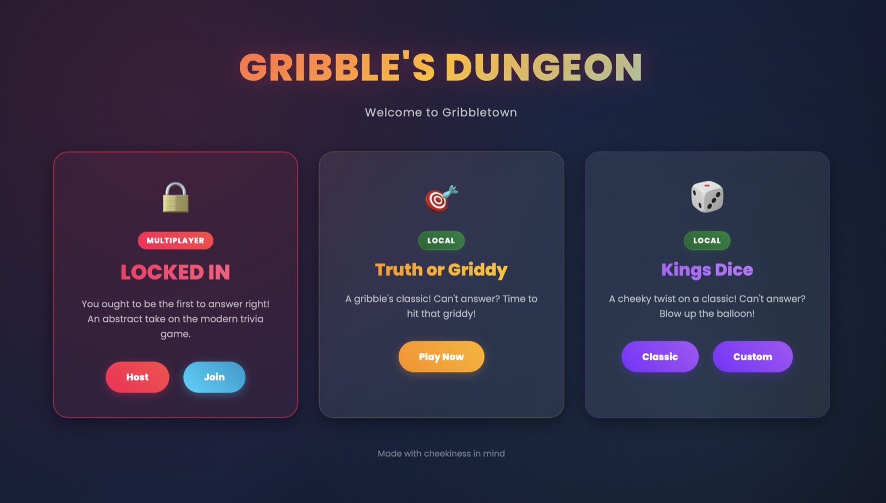
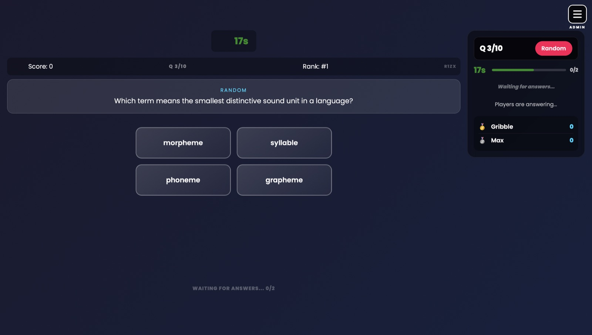
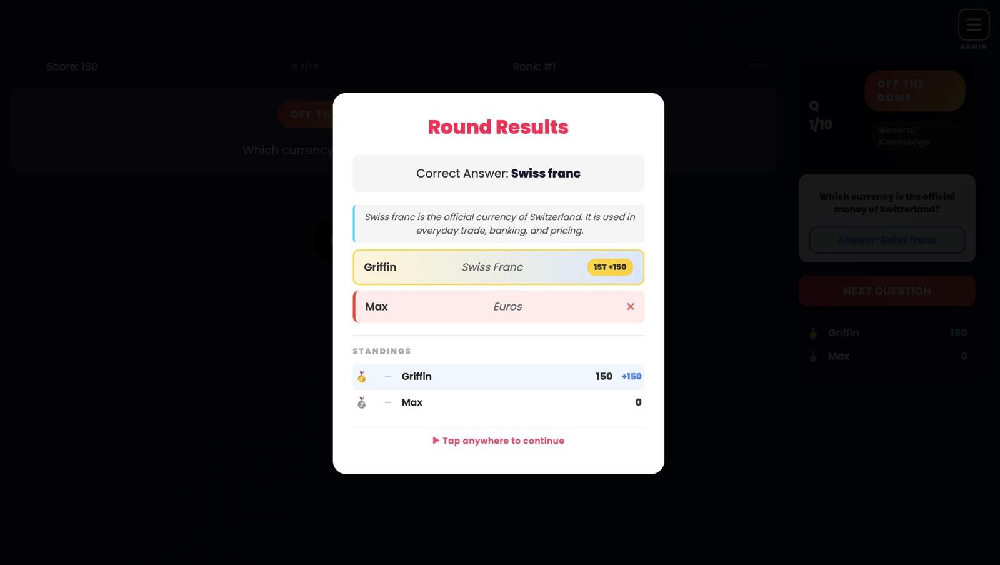
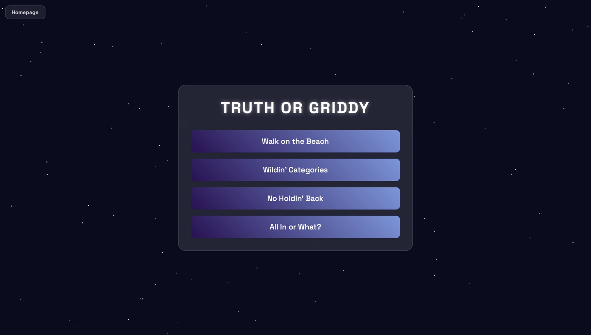
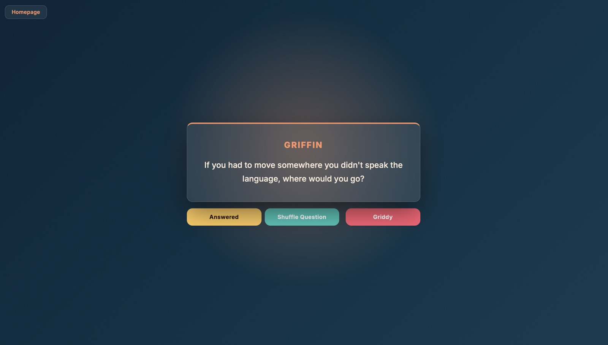
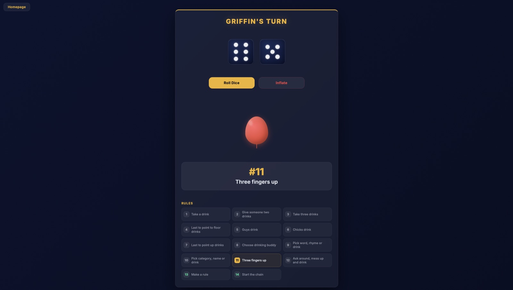
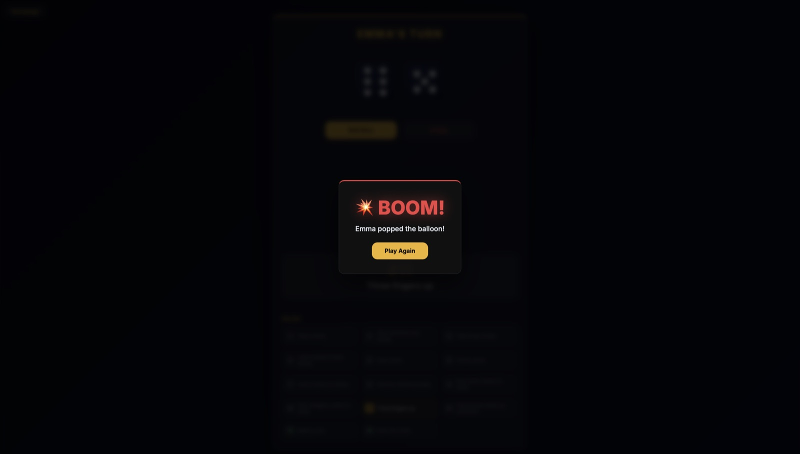
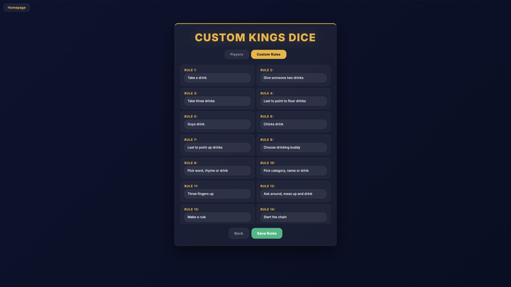

# GriffinGames

Party games I built to play with friends. Everything runs in the browser, no installs or accounts. One person puts it on a TV or laptop and everyone else plays along.

**Play it:** https://griffinhgames.xyz



## Games

### LOCKED IN

A multiplayer trivia game show. The host sets up a room on the big screen, everyone joins from their phone with a room code, and the first person to hit "Lock In" gets to answer. There are 11 categories (geography, sports, movies & TV, flags, and more) with around 6,000 questions total, plus "Off the Dome" free-response rounds where answers are graded by an LLM (Llama 3.1 via Groq), so typos and alternate spellings still count. It talks to a Node/Socket.IO backend: [griffinhgames-server](https://github.com/griffinhaag/griffinhgames-server).

<table>
  <tr>
    <td></td>
    <td></td>
  </tr>
</table>

### Truth or Griddy

A question-card game with four themed decks, each with its own color scheme and roughly 500 prompts. Can't answer? You hit the griddy.

<table>
  <tr>
    <td></td>
    <td></td>
  </tr>
</table>

### Kings Dice

Roll the dice and the total picks a rule from the board. Rather not? Pump the balloon instead, and hope it doesn't pop on you. It bursts at a random point. There's also a custom mode for writing your own rules.

<table>
  <tr>
    <td></td>
    <td></td>
    <td></td>
  </tr>
</table>

## How it's built

- Plain HTML, CSS, and JavaScript. No framework or build step, so each game is just a folder you can open.
- LOCKED IN uses Socket.IO for real-time rooms, buzzing, scoring, and reconnects. `config.js` points the site at the production server on Render, or at `localhost:3000` when running locally.
- Hosted on Netlify and deployed straight from this repo.

## Project layout

```
index.html            Main menu
config.js             Picks the backend URL (production vs. local)
games/
  buzzin/             LOCKED IN: host setup, lobby/game screen, phone join page
  truthOrgriddy/      Truth or Griddy and its four category decks
  Kings Dice/         Kings Dice plus the custom-rules version
docs/screenshots/     Images used in this README
tests/e2e/            Browser tests that play every game end to end
```

## Running locally

Any static file server works:

```bash
npx serve .
```

Then open the URL it prints. For LOCKED IN, also run the [server](https://github.com/griffinhaag/griffinhgames-server) on port 3000. The site detects `localhost` and connects to it automatically.

## Tests

`tests/e2e` has browser tests that play every game the way people do: a full LOCKED IN game with a host and players in separate tabs, every Truth or Griddy deck to the end, and both versions of Kings Dice. See [tests/e2e/README.md](tests/e2e/README.md) for what's covered and how to run them.
